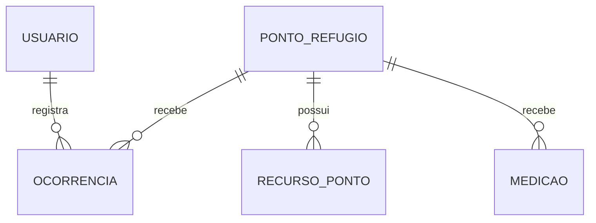

# Refúgio

O Refúgio reúne informações sobre pontos de alívio térmico, seus horários, recursos e condições ambientais. A API permite consultar os locais, registrar ocorrências e acompanhar o atendimento. Gestores mantêm os cadastros e atualizam a situação dos relatos.

## Equipe

| Integrante | RM | Turma |
| --- | --- | --- |
| Guilherme Soares | 568227 | A preencher pela equipe |
| Demais integrantes | A preencher pela equipe | A preencher pela equipe |

## Tecnologias

Java 21, Spring Boot 3.5.16, Maven Wrapper e PostgreSQL 16. A API usa Spring Data JPA, Bean Validation, Spring Security com JWT, Spring Cache, HATEOAS, Actuator e Swagger/OpenAPI.

## Executar pelo IntelliJ

É necessário ter JDK 21, IntelliJ IDEA e PostgreSQL 16. O Maven Wrapper está incluído no repositório; não é preciso instalar Maven separadamente.

### 1. Baixar o projeto

```powershell
git clone https://github.com/Guilherme-Soares00/refugio.git
Set-Location .\refugio
```

Abra essa pasta no IntelliJ e importe o `pom.xml`. Configure o SDK do projeto e o Maven Runner com JDK 21, sem preview.

### 2. Preparar o PostgreSQL

Com o servidor PostgreSQL em execução, conecte-se pelo `psql`, pgAdmin ou outro cliente SQL usando uma conta com permissão para criar usuários e bancos.

No `psql`, os comandos abaixo criam o usuário da aplicação, solicitam sua senha e criam o banco:

```text
CREATE ROLE refugio_app LOGIN;
\password refugio_app
CREATE DATABASE refugio OWNER refugio_app;
```

Se o banco e o usuário já existirem, use os dados dessa conexão. Não execute os comandos de criação novamente. As tabelas são criadas ou atualizadas pela aplicação no primeiro início.

### 3. Configurar a aplicação

Em **Run > Edit Configurations**, selecione a configuração de `RefugioApplication` ou crie uma configuração **Application** com:

- Classe principal: `br.com.fiap.refugio.RefugioApplication`.
- Módulo: `refugio`.
- JDK: 21.
- Diretório de trabalho: a raiz do projeto.

No campo **Environment variables**, configure:

| Variável | Valor |
| --- | --- |
| `SPRING_DATASOURCE_URL` | `jdbc:postgresql://localhost:5432/refugio`, ajustando servidor e porta se necessário |
| `SPRING_DATASOURCE_USERNAME` | `refugio_app` ou o usuário criado no seu PostgreSQL |
| `SPRING_DATASOURCE_PASSWORD` | A senha desse usuário |
| `JWT_SECRET` | Uma chave Base64 com pelo menos 32 bytes aleatórios, gerada abaixo |
| `APP_SEED_ENABLED` | `true` para carregar os dados iniciais de teste |
| `SERVER_ADDRESS` | `127.0.0.1` para acesso local |
| `SERVER_PORT` | `8080` |
| `CORS_ALLOWED_ORIGINS` | `http://localhost:3000` |

Para gerar a chave JWT no PowerShell:

```powershell
$bytes = New-Object byte[] 32
$gerador = [System.Security.Cryptography.RandomNumberGenerator]::Create()
try { $gerador.GetBytes($bytes) } finally { $gerador.Dispose() }
[Convert]::ToBase64String($bytes)
```

Copie o resultado para `JWT_SECRET`. Não publique a chave nem a senha do banco. O arquivo `.env.example` lista as variáveis disponíveis, mas o Spring Boot não carrega `.env` automaticamente. Informe os valores na configuração de execução da IDE.

### 4. Iniciar

Execute `RefugioApplication` pelo **Run**. Depois da inicialização:

- Saúde da API: <http://localhost:8080/actuator/health>.
- Swagger UI: <http://localhost:8080/swagger-ui/index.html>.
- Especificação OpenAPI: <http://localhost:8080/v3/api-docs>.

Para encerrar, use **Stop** no IntelliJ. Se a porta 8080 estiver ocupada, escolha outra em `SERVER_PORT` e ajuste as URLs usadas pelo cliente.

## Dados iniciais e contas de teste

Com `APP_SEED_ENABLED=true`, a aplicação carrega 10 usuários, 10 pontos, 20 recursos, 10 medições e 10 ocorrências. Esses registros são fictícios e servem para testar os fluxos. A carga não sobrescreve registros existentes nem duplica os dados em reinicializações sequenciais. Por padrão, ela fica desabilitada.

| Papel | E-mail | Senha fictícia |
| --- | --- | --- |
| CIDADAO | `cidadao01@example.test` | `CidadaoDemo2026!` |
| GESTOR | `gestor09@example.test` | `GestorDemo2026!` |

Os novos cadastros recebem o papel `CIDADAO`. O papel `GESTOR` permite manter os pontos e tratar ocorrências. As contas da tabela são públicas e devem ser usadas somente no ambiente de testes.

## Usar a API

As consultas de pontos são públicas. Para acessar uma operação protegida pelo Swagger:

1. Execute **POST `/api/auth/login`** com e-mail e senha.
2. Copie o campo `accessToken` da resposta.
3. Abra **Authorize** e informe somente o token.

O login retorna `accessToken`, `tipo` e `expiresIn`. Outros clientes devem enviar o token no cabeçalho `Authorization`, com esquema `Bearer`. As senhas são armazenadas com BCrypt, e o JWT tem validade configurável por `JWT_EXPIRATION_SECONDS`, com padrão de 3600 segundos.

| Método | Rota | Acesso |
| --- | --- | --- |
| POST | `/api/auth/cadastro`, `/api/auth/login` | Público |
| GET | `/api/pontos`, `/api/pontos/busca`, `/api/pontos/{id}` | Público |
| GET | `/api/pontos/{id}/recursos`, `/api/pontos/{id}/medicoes` | Público |
| POST | `/api/pontos`, `/api/recursos`, `/api/medicoes` | Gestor |
| PUT / DELETE | `/api/pontos/{id}`, `/api/recursos/{id}` | Gestor |
| POST | `/api/ocorrencias` | Cidadão ou gestor |
| GET | `/api/ocorrencias/minhas` | Usuário autenticado; retorna apenas suas ocorrências |
| PATCH | `/api/ocorrencias/{id}/status` | Gestor |
| GET | `/actuator/health`, `/actuator/info` | Público |
| GET | `/actuator/metrics` e métricas individuais | Gestor |

A listagem recebe `page`, `size` e `sort`. A página começa em zero, o tamanho aceito é de 1 a 100 e o padrão é 20. Use `/api/pontos/busca` para filtrar por bairro, status e recurso disponível:

```powershell
curl.exe "http://localhost:8080/api/pontos?page=0&size=2"
curl.exe "http://localhost:8080/api/pontos/busca?bairro=Centro%20Piloto&status=ATIVO&tipoRecurso=AGUA"
```

As listas usam HAL, com `_embedded`, `_links` e `page`. Em listas vazias, `_embedded` pode não aparecer. Os detalhes incluem links para recursos relacionados e ações disponíveis; a autorização continua sendo verificada pela API.

## Regras de negócio

- O código público do ponto segue `REF-NNN`, é único e não pode ser alterado.
- Cada ponto pode ter apenas um recurso de cada tipo.
- Pontos com recursos, medições ou ocorrências não podem ser excluídos. Eles podem ser inativados sem perder o histórico.
- A temperatura aceita valores de 0 a 60 °C, e a umidade, de 0 a 100%.
- O autor da ocorrência vem do usuário autenticado. A prioridade é calculada pelo servidor: acesso bloqueado é alta, falta de água ou sombra é média, e outras categorias recebem baixa.
- A ocorrência nasce aberta. Apenas gestores podem avançá-la para em análise e depois resolvida. Uma ocorrência resolvida não volta ao estado anterior.

Criações retornam 201; consultas, 200; alterações e exclusões, 204. Erros usam os códigos 400, 401, 403, 404 ou 409 conforme a situação, com corpo padronizado em `status`, `erro`, `mensagem`, `path` e `timestamp`.

## Modelo de dados



Os relacionamentos usam carregamento `LAZY`. Não há remoção em cascata das coleções, para evitar a perda do histórico. O detalhe de um ponto busca seus recursos e a última medição sem carregar todas as medições e ocorrências. A conversão para DTO ocorre dentro da transação, com `open-in-view=false`.

## Consultas e cache

O projeto usa três formas de consulta:

- **Método derivado:** lista pontos por status quando não há ordenação explícita. Mantém a consulta simples e legível.
- **JPQL com `@Query`:** busca pontos com um recurso disponível. O `DISTINCT` evita repetir pontos por causa dos relacionamentos.
- **Specification:** combina bairro, status e recurso conforme os filtros recebidos, sem montar SQL por concatenação.

O cache `pontoDetalhe` guarda os dados de cada ponto por ID, incluindo recursos e última medição. Ele reduz consultas repetidas desse detalhe. Escritas em pontos, recursos e medições invalidam as entradas afetadas; ao mover um recurso, o ponto de origem e o de destino são invalidados. Links que dependem da requisição ou do usuário são montados fora do conteúdo cacheado. O cache é local a cada JVM.

## Organização

```text
src/main/java/br/com/fiap/refugio/
  auth/        cadastro, login, usuário e JWT
  ponto/       entidade, repository, service, controller e DTOs
  recurso/     entidade, repository, service, controller e DTOs
  medicao/     entidade, repository, service, controller e DTOs
  ocorrencia/  entidade, repository, service, controller e DTOs
  common/      erros e paginação
  config/      configurações e seed
```

## Testes

A suíte de integração usa PostgreSQL real e recria tabelas e schemas. Prepare um banco exclusivo chamado `refugio_test`, com usuário autorizado a criar e remover esses objetos. Nunca use a base da aplicação nem execute suítes em paralelo no mesmo banco.

No PowerShell, na raiz do projeto:

```powershell
$env:TEST_DATABASE_URL = 'jdbc:postgresql://localhost:5432/refugio_test'
$credencial = Get-Credential -UserName 'refugio_test' -Message 'Acesso ao banco de testes'
$env:TEST_DATABASE_USERNAME = $credencial.UserName
$env:TEST_DATABASE_PASSWORD = $credencial.GetNetworkCredential().Password
.\mvnw.cmd -B verify
```

Ajuste host, porta e usuário à sua instalação. A URL precisa terminar em `/refugio_test`, sem parâmetros. Os relatórios ficam em `target/surefire-reports`.

## Cliente web

O [Refúgio Web](https://github.com/Guilherme-Soares00/refugio-web) é um cliente separado, usado para apresentar os fluxos da API no vídeo. Para executá-lo, siga o README desse repositório. A aplicação Java e o PostgreSQL não dependem dele.
